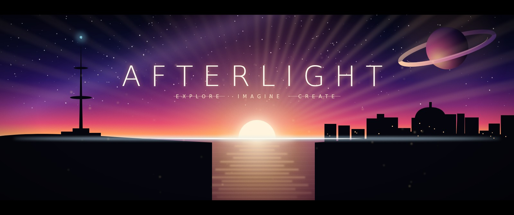
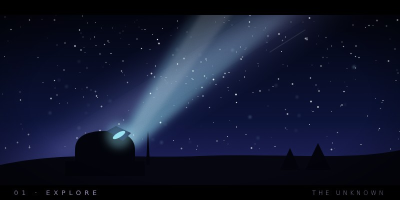
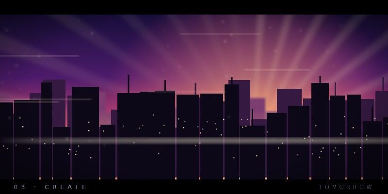

<div align="center">



</div>




**AFTERLIGHT** is a futuristic digital magazine and creative inspiration platform for future exploration. It is designed to keep **verified facts, active research, predictions, plausible scenarios and creative speculation visibly distinct**.

The application does not ship fabricated research or example articles. Published content is read from **Supabase** and must pass the editorial workflow.

<table>
<tr>
<td width="33%"></td>
<td width="33%"></td>
<td width="33%"></td>
</tr>
</table>




Every note carries one of five explicit classifications, enforced in both the interface and the database. Fact, research and prediction submissions require **at least one verified reference**. Unverified sources are hidden from public readers.




- An **editor** verifies references and approves a submission into a **private draft**.
- The editor then completes the article sections and **explicitly publishes** it.
- If an editor requests changes, the author receives required, actionable feedback and can revise and resubmit.
- Changes to a published article's content, classification, category or image need a **20 to 500 character change note**. PostgreSQL stores the earlier version and note in an append-only history, and readers can inspect earlier versions on the article page.

## Features

| | |
| :--- | :--- |
| 🔭 **Explore** | Indexed PostgreSQL full-text search over titles, summaries and editorial sections, with category and classification filters, relevance, title and date sorting, and bounded load-more pagination. Published articles only. |
| 🧱 **Structured articles** | Introduction, background, current scientific understanding, future possibilities and limitations. |
| 🌐 **Community** | Trending published notes, visible discussion excerpts, recent contributors and live aggregate statistics. Only aggregate counts are exposed; bookmarks and private submissions are never included. |
| 👤 **Contributor profiles** | Public bio, avatar, display name and published notes. Members can edit only those profile fields. |
| 💬 **Comments and reports** | Signed-in readers can privately report a visible comment. Editors resolve reports with a recorded note, and reporters get an inbox notification. Comment authors are notified only when a comment is hidden or removed. |
| 🔔 **Member tools** | Profiles, saved notes, submission status, editorial feedback and notifications. |
| 🔐 **Roles** | Registration always creates a `member`. Only an existing administrator can change roles, enforced in PostgreSQL. |
| ✨ **Motion** | Responsive React interface with animated route transitions and an accessible navigation shell. |








The authenticated **research assistant** is grounded in published notes only.

- It uses published AFTERLIGHT notes and the references visible to the signed-in user under their row-level security policies. It does **not** search the web and does **not** save conversations.
- Answers link to verified references, disclose uncertainty, and are clearly labeled **AI-generated**. They are never marked as verified, never added to articles automatically, and are not a substitute for editorial review.
- Each account is limited to **10 requests per hour**.
- Questions and relevant excerpts are sent to OpenAI when submitted, so avoid personal or confidential details.

<details>
<summary><b>✦ Deploy the assistant function</b></summary>

<br/>

1. In Supabase project settings, add `OPENAI_API_KEY` as an Edge Function secret. Optionally add `OPENAI_MODEL` (default `gpt-4o-mini`). Never put these in `VITE_` variables or commit them.
2. Deploy: `supabase functions deploy research-assistant`
3. For local development, copy `supabase/.env.example` to the ignored `supabase/.env.local`, set your key, then run:

```bash
supabase functions serve research-assistant --env-file supabase/.env.local
```

4. In the app, sign in and open **Research assistant**.

</details>




1. Install **Node.js 20.19+ or 22.12+**.
2. Install dependencies: `npm install`
3. Copy `.env.example` to `.env.local` and add your Supabase project URL and public anon (publishable) key.
4. Apply every migration **in order** (see below).
5. Start Vite: `npm run dev`

Without Supabase credentials, the public interface stays navigable but explains that the research desk is offline. Authentication, submissions and article data are never simulated.

<details>
<summary><b>✦ The ten migrations, in order</b></summary>

<br/>

```text
supabase/migrations/202611010001_initial_schema.sql
supabase/migrations/202611010002_editorial_media_notifications.sql
supabase/migrations/202611010003_separated_editorial_workflow.sql
supabase/migrations/202611010004_research_assistant.sql
supabase/migrations/202611010005_community_activity.sql
supabase/migrations/202611010006_contributor_profiles.sql
supabase/migrations/202611010007_explore_search.sql
supabase/migrations/202611010008_article_revision_history.sql
supabase/migrations/202611010009_comment_reports.sql
supabase/migrations/202611010010_moderation_notifications.sql
```

In the Supabase SQL Editor, run each file once, in order. With the CLI, run `supabase link --project-ref <project-ref>` once, then `supabase db push`.

</details>


- Enable **email/password** authentication and configure email confirmation in Supabase Auth.
- The migrations create profiles, categories, submissions, structured articles, sources, comments, comment reports, reactions, bookmarks, editorial reviews, notifications, indexes, role checks, image storage policies, row-level security policies, a private assistant rate-limit store, community aggregates, contributor bios, indexed Explore search, revision history and moderation notifications.
- Local Supabase config lives in `supabase/config.toml`, with auth redirects set for Vite on port 5173. Seed data is intentionally disabled.
- **First administrator:** find their profile UUID in the Supabase dashboard and run this in the SQL editor:

```sql
update public.profiles set role = 'administrator' where id = '<auth-user-uuid>';
```

- **Images** use the `article-images` storage bucket: 5 MB limit, JPG, PNG, WebP or AVIF, randomized object names, and members can upload only to their own folder. Images are public by URL.
- Keep database access behind the included RLS policies. The browser only receives the Supabase URL and public anon key. **Never** put the service-role key in a `VITE_` variable or frontend source.


**Vercel**

1. Import the project and select the **Vite** framework preset.
2. Add `VITE_SUPABASE_URL` and `VITE_SUPABASE_ANON_KEY` as environment variables for the environments you deploy to.
3. Deploy. `vercel.json` routes client-side navigation to the Vite app.
4. Add the deployed domain to Supabase Auth's allowed redirect URLs. Configure `afterlight.world` only after confirming domain availability and completing DNS setup.


```bash
npm run lint     # TypeScript check
npm run build    # TypeScript check and production Vite build
```

<details>
<summary><b>✦ Project structure</b></summary>

```text
Afterlight/
├── .github/workflows/   # GitHub Actions workflows
├── public/              # Static assets
├── src/                 # React + TypeScript application
├── supabase/            # config.toml, migrations, edge function
├── index.html
├── vite.config.ts
├── vercel.json          # SPA routing for Vercel
├── .env.example
└── package.json
```

</details>


